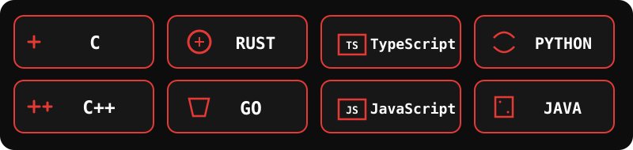

# Hey, I’m lust.

**CS student · builder · always up for a challenge**

I’m an 18-year-old CS student who loves figuring out how things work and building cool stuff. I bring a lot of energy, learn fast, and I’m **always open to helping out** — send me a project!

[GitHub](https://github.com/fulloflust) · [Repositories](https://github.com/fulloflust?tab=repositories)

## What I’m up to

- Former owner of **Catalyst** — the project has been discontinued.
- Currently working with **Light Client** and helping with **LARP Client**.
- Always down to learn, build, and help where I can.

## Languages I’m strongest in

I also work with **Lua, SQL, PHP, Bash and shell, Kotlin, Swift, C#, and Ruby**. Still building confidence with those.

---

