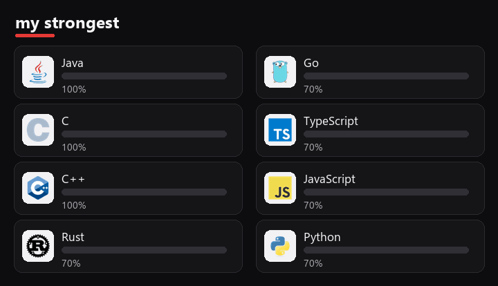
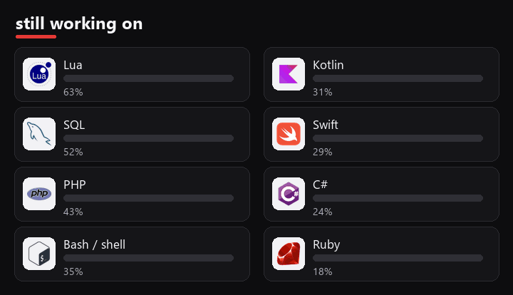

# yo im lust

im 18 and a cs student i love building stuff learning new things and helping people out

**im always open to help so hit me up if you need a hand**

[my github](https://github.com/fulloflust) { [my projects](https://github.com/fulloflust?tab=repositories) }

## what im up to

- ex owner of **Catalyst** it got discontinued
- working with **Light Client**
- helping with **LARP Client**

## languages i know

## github stats

